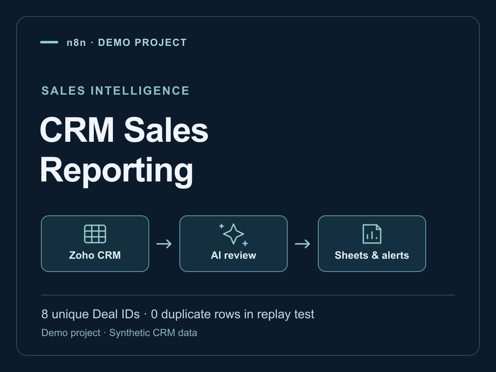
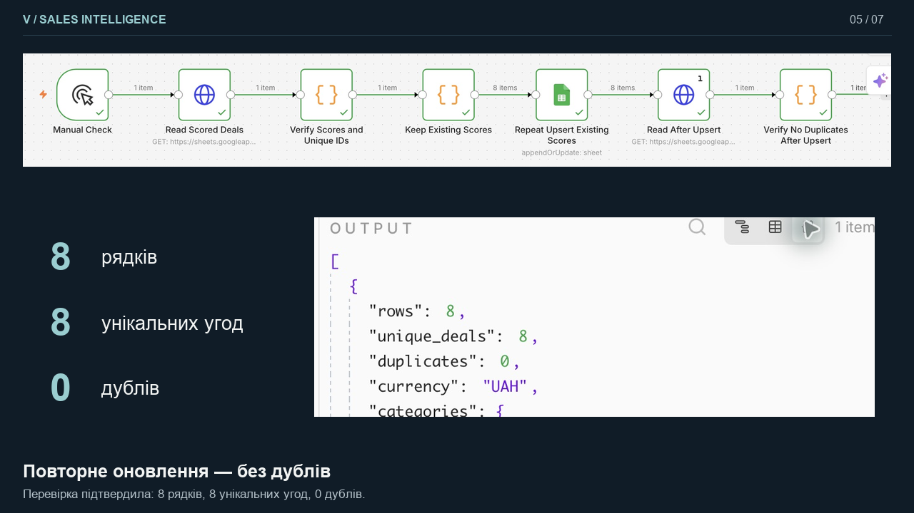

# CRM sales reporting — structured deal assessments

**Type:** Independent portfolio demo using synthetic Zoho CRM data.

## Why I built it

Deal context can be spread across CRM records, notes, calls and tasks. I wanted to combine that context into consistent reports and practise updating an existing report without creating another row for the same deal.

## What I built

Three n8n reporting workflows produce a daily sales brief, a weekly deal-health review and a Friday forecast. A separate context-tool workflow retrieves the relevant Zoho CRM information for the AI agent. Structured output is validated before Google Sheets is updated by Deal ID. Telegram delivers reports and priority alerts.

**Flow:** Zoho CRM context → AI assessment → structured-output checks → update Sheets by Deal ID → deliver report or alert.

## Why this approach

A reusable context tool keeps data retrieval separate from reporting. The Deal ID is a stable update key, so a repeated assessment can replace the existing row. A defined output structure makes missing fields easier to detect before writing results.

## Test results

- 12 sample deals reviewed; the daily analysis made seven AI tool calls.
- Eight deals scored: three Critical, three Medium and two Normal.
- After repeated writes: eight rows, eight unique Deal IDs and zero duplicate rows.
- Successful executions were captured for all three reporting workflows and the context workflow.

## Replay-test evidence

## Current limits

The records are demo data. The priority ratings are model outputs, not proof of revenue impact or forecast accuracy. Production business ROI was not measured.

## What I learned

Repeated runs should update the same business entity consistently. Stable record keys and output validation are as important as the report prompt.

**Tools:** n8n, Zoho CRM, Google Sheets, OpenRouter, JavaScript, Telegram.

[Portfolio and execution evidence](https://nova-slice-e68.notion.site/Vadym-Dudka-3b7f35dfa98a80d485cfdf6ecab41b67)
