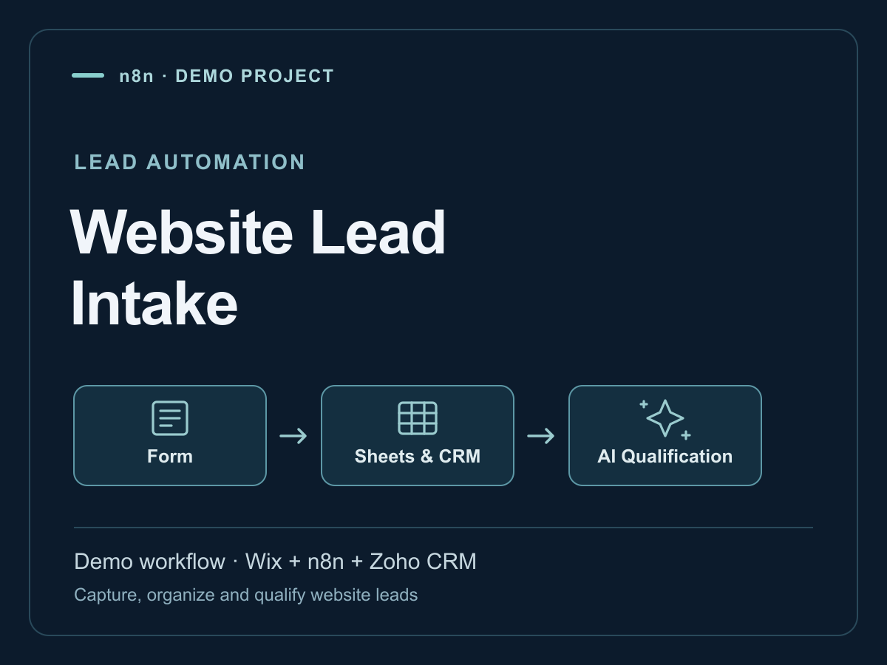
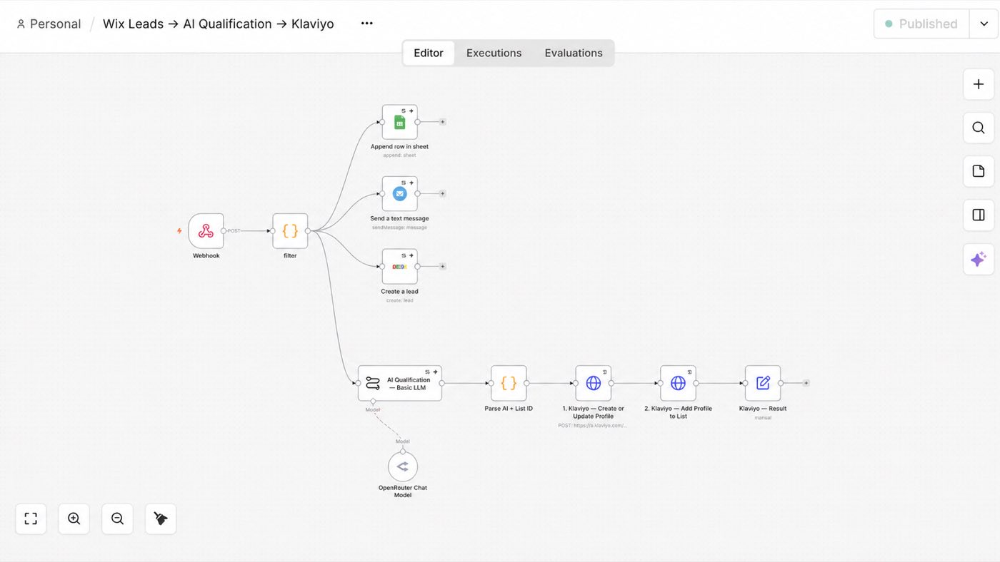

# Wix lead intake — form data across business tools

**Type:** Independent demo/training workflow.

## Why I built it

A website submission often needs to reach a spreadsheet, CRM, notification channel and email-marketing tool. I wanted to practise mapping one form payload across these services and adding a structured AI qualification step.

## What I built

A Wix webhook enters n8n. The workflow extracts the form fields and branches to Google Sheets, Telegram and Zoho CRM. A separate AI qualification path prepares Klaviyo profile properties and list selection, then calls the Klaviyo profile-import and list-membership APIs.

**Flow:** Wix form → n8n field mapping → Sheets / notification / Zoho lead; AI qualification → parse result → Klaviyo profile create-or-update → add to list.

## Why this approach

Webhook intake avoids manual transfer from the website. Explicit field mapping makes the destination requirements visible. The AI result is parsed into structured fields for the marketing branch.

## Implementation evidence

- 11-node n8n workflow.
- Four destination services: Google Sheets, Telegram, Zoho CRM and Klaviyo.
- Two Klaviyo API actions: profile create-or-update and list membership.
- The portfolio includes a recorded walkthrough of the implemented route.

These counts describe the implementation. They are not a measured conversion gain or a large test corpus.

## Workflow evidence

## Current limits and next improvement

The current workflow does not implement a global duplicate-event gate: the Sheets append, Zoho create and notification branches can run again when a submission is repeated. Email cleanup and validation are in the Klaviyo branch, rather than a shared validation step before every destination. There is no timed follow-up sequence or stop-on-reply behavior in this demo.

A useful next version would validate required fields before branching, persist a submission ID, and test that retries do not repeat records or notifications.

## What I learned

Connecting services is only one part of lead intake. Shared validation and repeat protection need their own design and tests.

**Tools:** n8n, Wix webhooks, Google Sheets, Zoho CRM, Klaviyo API, OpenRouter, JavaScript, Telegram Bot API.

[Workflow walkthrough](https://www.loom.com/share/a1f5f580da6949aa96f9aa5ede2e1563) · [Full portfolio](https://nova-slice-e68.notion.site/Vadym-Dudka-3b7f35dfa98a80d485cfdf6ecab41b67)
